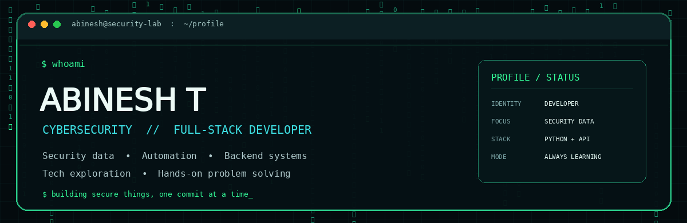

<div align="center">



### `CYBERSECURITY DEVELOPER` &nbsp; // &nbsp; `FULL-STACK BUILDER` &nbsp; // &nbsp; `TECH EXPLORER`

[](https://github.com/Abinesh-ryuk)
[](https://github.com/Abinesh-ryuk?tab=followers)
[](https://github.com/Abinesh-ryuk?tab=repositories)

</div>

---

## `01 // IDENTITY`

```bash
abinesh@security-lab:~$ whoami
```

Hey, I'm **Abinesh T** — a developer working in the **cybersecurity industry**, with a background in **B.Sc. Computer Technology**. I enjoy building useful software, working with security data, automating workflows, and exploring how technology works.

- 🎓 **Education:** B.Sc. Computer Technology — **79%**
- 💼 **Professional focus:** Cybersecurity development and security-data engineering
- 🧩 **Security work:** Log analysis, OCSF normalization and security event processing
- 🐍 **Backend:** Python, FastAPI and API integrations
- 📊 **Data:** SQL, Apache NiFi and ClickHouse
- 🌐 **Full-stack:** React and Supabase
- 🧠 **AI:** Prompt engineering and practical AI-assisted development
- 🔧 **Personal style:** Hands-on, curious and resourceful; I enjoy fixing, building and maintaining things
- 🌱 **Mindset:** Learn continuously, experiment thoughtfully and turn problems into practical solutions

> **Developer by profession. Tech explorer by passion. Handyman by nature.**

## `02 // TECH_ARSENAL`

<div align="center">

**LANGUAGES & CORE**


**BACKEND • FRONTEND • DATABASE**


**TOOLS & WORKFLOW**


</div>

**Also working with:** Apache NiFi · ClickHouse · OCSF · Log Analysis · Networking · Cybersecurity · Prompt Engineering

## `03 // SECURITY_LAB`

<table>
<tr>
<td width="50%" valign="top">

### 🛡️ Security & Data
- Security log analysis
- OCSF event normalization
- Security data processing
- Ingestion pipeline automation
- Networking fundamentals
- Cybersecurity engineering

</td>
<td width="50%" valign="top">

### ⚙️ Software Engineering
- Python backend services
- FastAPI development
- React interfaces
- Supabase integrations
- SQL and database work
- API integration & automation

</td>
</tr>
</table>

## `04 // PROJECTS_ON_THE_RADAR`

A selection of repositories from my GitHub. Open each project to see its source code and current implementation.

<table>
<tr>
<td width="50%" valign="top">

**[cyber-portfolio](https://github.com/Abinesh-ryuk/cyber-portfolio)**

Personal portfolio project.

</td>
<td width="50%" valign="top">

**[Dns-health-checker-api-project](https://github.com/Abinesh-ryuk/Dns-health-checker-api-project)**

DNS health-checking API project.

</td>
</tr>
<tr>
<td width="50%" valign="top">

**[React-OTP-Login-Dashboard](https://github.com/Abinesh-ryuk/React-OTP-Login-Dashboard)**

React-based OTP login dashboard.

</td>
<td width="50%" valign="top">

**[Login-otp-dashboard-vitesting](https://github.com/Abinesh-ryuk/Login-otp-dashboard-vitesting)**

Login dashboard and testing project.

</td>
</tr>
<tr>
<td width="50%" valign="top">

**[Public-API-for-generating-random-cat](https://github.com/Abinesh-ryuk/Public-API-for-generating-random-cat)**

Public API integration project.

</td>
<td width="50%" valign="top">

**[html-portfolio](https://github.com/Abinesh-ryuk/html-portfolio)**

HTML portfolio project.

</td>
</tr>
</table>

## `05 // GITHUB_TELEMETRY`

<div align="center">

### ⚡ Daily Contribution Streak

<table>
<tr>
<td width="50%" align="center">

**CURRENT STREAK**


</td>
<td width="50%" align="center">

**LONGEST STREAK**


</td>
</tr>
</table>

<sub>Streak counts are fetched dynamically by the stats service; they are not hard-coded. They may take time to refresh or be temporarily unavailable.</sub>

### GitHub Overview


</div>

## `06 // OFF_KEYBOARD`

<table>
<tr>
<td width="50%" valign="top">

- 💪 **Gym & Fitness** — discipline, consistency and progress
- 🎮 **Gaming** — strategy, challenge and fun
- 🎬 **Editing** — creativity and visual storytelling

</td>
<td width="50%" valign="top">

- 📚 **Reading** — learning beyond the screen
- 🧪 **Tech exploration** — trying tools and discovering how things work
- 🔧 **Handyman / DIY** — fixing, building and maintaining things

</td>
</tr>
</table>

## `07 // THE_PERSON_BEHIND_THE_CODE`

- **Curious:** I like exploring unfamiliar tools and understanding how things work.
- **Hands-on:** I prefer experimenting, building and fixing rather than only talking about ideas.
- **Resourceful:** I enjoy finding practical ways around problems.
- **Consistent:** I value discipline, daily improvement and learning over time.
- **Versatile:** I enjoy moving between software, technology, creative work and practical DIY tasks.

## `08 // CONNECT`

<div align="center">

[](https://github.com/Abinesh-ryuk)
[](https://github.com/Abinesh-ryuk?tab=repositories)


</div>
